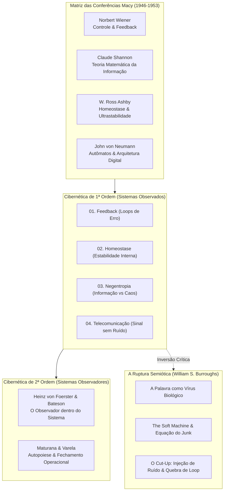
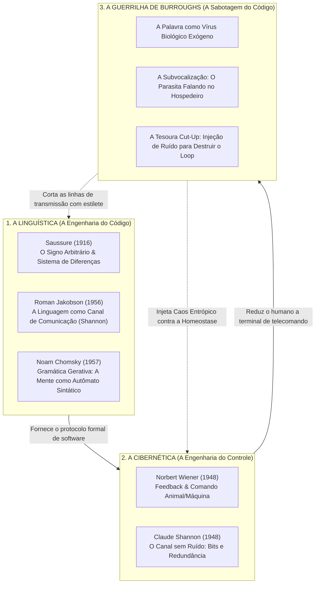
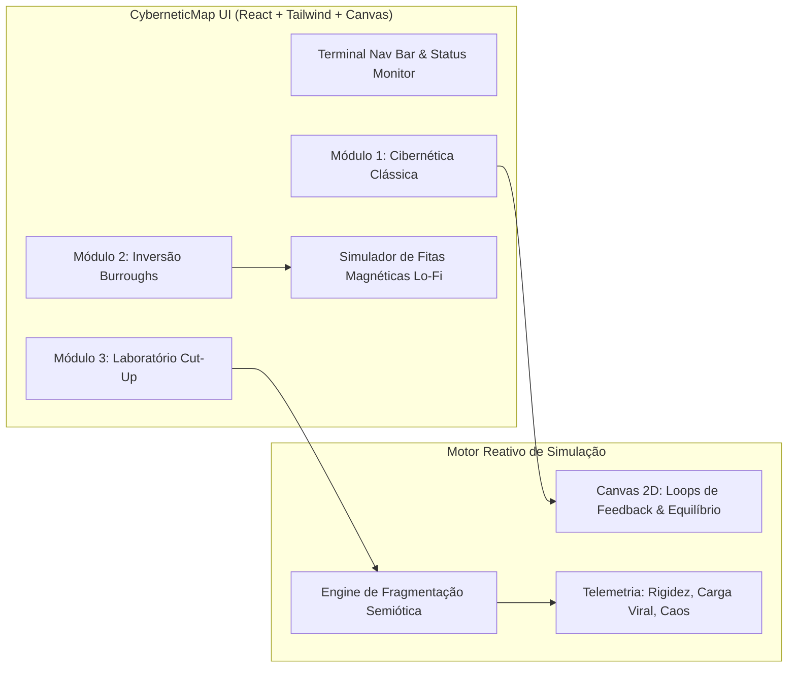

# RFC-001: CyberneticMap — Arquitetura Conceitual, Pilares Cibernéticos e Deploy no GitHub Pages

| Metadado | Detalhe |
| :--- | :--- |
| **RFC ID** | RFC-001 |
| **Título** | Arquitetura Conceitual da Cibernética, Semiótica de Controle e Pipeline de Publicação no GitHub Pages |
| **Status** | PROPOSTA (Ready for Review) |
| **Autor** | Antigravity AI & govinda777 |
| **Repositório** | [CyberneticMap](https://github.com/govinda777/CyberneticMap) |
| **Data** | Novembro de 2026 |
| **Versão Alvo** | v1.0.0-RELEASE |

---

## 1. Sumário Executivo

O projeto **CyberneticMap** é uma aplicação interativa e ensaio transmídia em formato web que investiga os fundamentos epistemológicos da **Cibernética de Primeira e Segunda Ordem** (Wiener, Ashby, Shannon, Von Foerster, Bateson) e estabelece um contraponto com a **Guerrilha Semiótica e Teoria Viral** de William S. Burroughs e Brion Gysin.

### O Desafio Atual
1. **Conceitual:** A aplicação possui protótipos de textos ricos, mas carece de uma consolidação teórica formal que articule com precisão cirúrgica os pilares da cibernética, suas crenças ontológicas (o mecanicismo sistêmico, o dogma da negentropia como vida e a redução da linguagem ao controle) e como a subversão do *Cut-Up* atua como um disjuntor cibernético.
2. **Técnico:** O repositório abriga atualmente um arquivo monolítico (`index.tsx` de 1.381 linhas) sem harness de compilação web (`package.json`, `vite.config.ts`, `index.html`, Tailwind CSS).
3. **Infraestrutura:** O workflow de automação existente (`.github/workflows/static.yml`) tenta enviar a raiz do repositório como artefato estático bruto, resultando em tela vazia ou falha no GitHub Pages, visto que navegadores não executam arquivos TypeScript/TSX nativamente sem empacotamento.

Esta RFC estabelece a visão teórica completa, a especificação funcional dos módulos, a arquitetura de engenharia de software e a esteira de entrega contínua para publicação definitiva no GitHub Pages.

---

## 2. Visão Clara da Cibernética: Pilares, Crenças e Epistemologia



### 2.1. O Que É a Cibernética?
O termo provém do grego **κυβερνήτης** (*kybernētēs* — timoneiro, piloto, governador náutico). Formalizada por Norbert Wiener em 1948 na publicação canônica *Cybernetics: Or Control and Communication in the Animal and the Machine*, a disciplina nasceu no cruzamento da engenharia militar (mira de baterias antiaéreas preditivas na Segunda Guerra Mundial), da neurofisiologia e da matemática computacional.

A promessa cibernética foi forjar uma **meta-ciência universal** capaz de descrever qualquer fenômeno — biológico, mecânico, cerebral, econômico ou social — sob a égide unificada de fluxos de informação, canais de comunicação e circuitos de controle autocorretivos.

---

### 2.2. Os Quatro Pilares Fundamentais (Cibernética Ortodoxa)

#### 1. Feedback (Retroalimentação Teleológica)
- **Princípio:** O comportamento de um sistema é governado pelo resultado de suas próprias ações pregressas.
- **Mecanismo:**
  $$\text{Erro}(t) = \text{Sinal de Referência (Alvo)} - \text{Saída Medida}(t)$$
- **Tipologia:**
  - **Feedback Negativo (Atenuador):** Reduz a discrepância em relação ao alvo programado. É a base da estabilidade mecânica, da pontaria balística e da regulação hormonal.
  - **Feedback Positivo (Amplificador):** Multiplica os desvios, gerando efeitos de avalanche, mutações catastróficas, corridas armamentistas ou colapsos de rede.
- **Inovação Filosófica:** A cibernética conferiu legitimidade mecânica à *teleologia* (propósito). Uma máquina que busca uma meta não precisa de alma ou intenção metafísica: basta um sensor que subtraia o erro e acione um servomotor.

#### 2. Homeostase e Ultrastabilidade
- **Origem:** Desenvolvida por Walter Cannon na fisiologia e estendida ao extremo por W. Ross Ashby em seu célebre *Homeostato* (1948).
- **Princípio:** Capacidade de um sistema aberto preservar a constância de suas variáveis essenciais vitais (temperatura, pressão arterial, suprimento energético) em meio a perturbações externas hostis.
- **Dinâmica:** Se a perturbação ultrapassa os limites toleráveis, sistemas *ultrastáveis* recombinam internamente suas conexões até encontrarem uma nova zona estocástica de equilíbrio dinâmico.
- **A Tensão Política:** A homeostase trata toda anomalia ou singularidade como uma patologia térmica a ser neutralizada e amortecida em nome da preservação do status quo.

#### 3. Entropia vs. Negentropia (Informação como Salvação Cósmica)
- **A Equação:** Claude Shannon e Norbert Wiener conectaram a Segunda Lei da Termodinâmica (Boltzmann) à Teoria da Informação:
  $$I = -\sum p_i \log_2 p_i$$
- **A Concepção:** O universo físico tende inexoravelmente à degradação térmica, à indistinção molecular e ao caos máximo (entropia).
- **O Dogma Cibernético:** A vida e as máquinas inteligentes são "enclaves negentrópicos" — vórtices locais que sugam ordem do meio para manter padrões estruturados de informação contra a corrente cósmica da entropia.
- **Fórmula Axiomática:**
  $$\mathbf{Ordem = Informa\text{ç}\tilde{a}o = Vida} \quad \longleftrightarrow \quad \mathbf{Caos = Desordem = Ru\acute{\imath}do = Morte}$$

#### 4. Controle e Comunicação (A Doutrina do Canal)
- **Princípio:** Controlar um sistema equivale a comunicar-se com ele de forma asséptica.
- **O Ideal do Canal:** O transmissor envia uma mensagem codificada por meio de um meio condutor até um receptor.
- **A Eliminação do Ruído:** Qualquer interferência, polissemia ou ambiguídade semântica que corrompa a fidelidade da mensagem de comando é classificada como *ruído* (imperfeição destrutiva) a ser expurgada por meio de filtros de sinal e códigos corretores de erro.

---

### 2.3. A Cibernética de Segunda Ordem: O Observador no Circuito
Nos anos 1970, Heinz von Foerster, Gregory Bateson, Humberto Maturana e Francisco Varela denunciaram o ponto cego da primeira cibernética: a pretensão positivista de um cientista isolado observando um sistema de fora.
- **Sistemas Observados $\rightarrow$ Sistemas Observadores:** O observador não está no exterior; seus atos de distinção linguística e epistemológica fazem parte do loop retroalimentado.
- **Autopoiese:** Sistemas vivos são máquinas que se autoproduzem recursivamente em redes de operações fechadas, determinando seus próprios limites cognitivos.

---

### 2.4. As Crenças e Dogmas Invisíveis da Razão Cibernética
Para compreender a crítica e o valor do projeto, o CyberneticMap sintetiza as premissas ontológicas da cibernética que moldaram a sociedade contemporânea:

1. **O Isomorfismo Universal (Animais = Máquinas):** A convicção ontológica de que não há distinção substancial entre a cognição de um ser humano, o voo guiado de um falcão, uma colônia de formigas e um computador militar. Todos são autómatos probabilísticos processadores de dados.
2. **A Desmaterialização do Real:** A máxima de Wiener: *"Information is information, not matter or energy"*. O mundo é reduzido a padrões imateriais de bits. O corpo físico passa a ser visto apenas como um suporte passageiro para a circulação de códigos.
3. **A Sociedade de Controle (Deleuze / Wiener):** A governança social deixa de depender apenas de muros disciplinares físicos (prisões, fábricas) e passa a operar pela modulação cibernética contínua: algoritmos preditivos, crédito contínuo, biometria e loops invisíveis de feedback comportamental.
4. **O Horror ao Ruído:** A exigência de que qualquer desvio, desordem ou ruído semântico seja corrigido em tempo real.

---

### 2.5. Onde a Linguística Entra e Onde Fica William S. Burroughs?

A fusão entre Cibernética e Teoria Crítica exige responder a duas perguntas vitais: **onde a linguística entra** no paradigma e **onde se posiciona William S. Burroughs** em relação a ela?



#### A. Aonde a Linguística Entra?
A linguística entra como o **fornecedor do protocolo de software** da cibernética:
1. **Ferdinand de Saussure (1916):** Ao dissociar o *Significante* do *Significado* e definir a língua como um sistema puramente relacional de oposições abstratas, Saussure descorporificou a linguagem, permitindo que ela fosse tratada formalmente como um *código simbólico autônomo*.
2. **Roman Jakobson (1956):** Membro ativo dos círculos cibernéticos pós-Macy, Jakobson unificou a linguística à Teoria da Informação de Shannon. Ele mapeou a fala humana no circuito `Emissor → Canal (sem ruído) → Código → Mensagem → Receptor`, estruturando a linguagem em dois eixos matemáticos: *Seleção (Paradigma)* e *Combinação (Sintaxe)*.
3. **Noam Chomsky (1957):** Chomsky modelou a cognição humana como um computador inato (Dispositivo de Aquisição de Linguagem) dotado de regras algorítmicas recursivas. A mente humana passou a ser descrita oficialmente como um **autômato processador de sintaxe**.

#### B. Aonde Fica William S. Burroughs?
Burroughs não é um linguista contemplativo; é um **parasitologista cultural e guerrilheiro semiótico**:
1. **A Descoberta do Vírus:** Burroughs aceita a premissa de Chomsky e Wiener de que o cérebro humano opera como uma máquina programável por código, mas faz a denúncia biológica definitiva: **"A palavra é literalmente um vírus alienígena"**. A conversa interna incessante (*subvocalização*) não é a voz da nossa alma, mas o parasita se replicando nas células cerebrais.
2. **A Coleira da Sintaxe Linear:** A fórmula sintática `[Sujeito + Verbo + Predicado]` impõe artificialmente a ilusão do Ego, a causalidade mecânica rígida e o tempo pré-gravado (*pre-sent*).
3. **A Tesoura Cut-Up como Arma Antiequipamento:** Enquanto Shannon e Wiener dedicam suas vidas a eliminar o ruído para que o comando seja cumprido, **Burroughs utiliza o ruído entrópico da Tesoura Cut-Up para sabotar o canal**. Cortar o texto em 4 quadrantes quebra os eixos de Jakobson e desativa o loop de feedback do Controle.

---

### 2.6. As Quatro Recapitulações Fundamentais

| # | Pergunta Guia | Síntese Epistemológica | Fórmula / Operação | Contra-Ação de Burroughs |
| :-: | :--- | :--- | :--- | :--- |
| **01** | *Aonde a Linguística entra?* | Formaliza a linguagem humana como um código abstrato e determinístico de transmissão de sinal, permitindo o telecomando cibernético. | $\text{Linguagem} = \text{Código} - \text{Ruído}$ | Desmascarar o código como software do poder. |
| **02** | *Aonde fica Burroughs?* | No ponto de curto-circuito biológico: a palavra é um organismo invasor que colonizou a glote e os neurônios do primata. | $\text{Humano} + \text{Palavra} = \text{Soft Machine}$ | Conscientizar-se da subvocalização parasitária. |
| **03** | *Por que a sintaxe linear aprisiona?* | A ordem [Sujeito $\rightarrow$ Ação $\rightarrow$ Objeto] tranca a cognição em tempo linear falso e obediência à causa-efeito. | $\text{Sintaxe} = \text{Tempo Falso (Pre-Sent)}$ | Quebrar a gramática para abrir o silêncio neural. |
| **04** | *Como o Cut-Up sabota o sistema?* | Introduz ruído estocástico maciço no canal, destruindo o feedback homeostático do Estúdio da Realidade. | $\text{Tesoura Cut-Up} \Rightarrow \Delta\text{Entropia} \uparrow$ | *"Quando você corta as frases, o futuro vaza."* |

---

## 3. Arquitetura da Solução CyberneticMap

A aplicação estrutura-se em uma interface imersiva com temática **Dark Terminal Militar / Laboratório Cyberpunk**, articulando rigor histórico e experimentação tátil.



### 3.1. Especificação dos Módulos Funcionais

#### Módulo 1: O Núcleo Cibernético (`#cybernetics`)
- **Visualizador dos 4 Pilares:** Cartões interativos detalhando Feedback, Homeostase, Entropia vs Negentropia e Telecomunicações com suas respectivas equações matemáticas fundamentais.
- **Simulador Interativo de Servomecanismo:**
  - Gráfico em tempo real de perturbação e recuperação homeostática desenhado em Canvas.
  - Controles deslizantes: *Nível de Perturbação Externa* vs. *Tensão de Controle Cibernético*.
  - Alternância de comportamento: Sistema Aberto/Adaptativo versus Sistema Fechado/Totalitário.

#### Módulo 2: A Inversão Viral (`#burroughs`)
- **Dossiê Comparativo Interativo:** Duelo conceitual direto entre a visão tecnocrática de Wiener/Shannon e a contracultura semiótica de Burroughs.
- **Conceitos Chave:** O Vírus da Palavra, The Soft Machine, A Equação do Junk, O Estúdio da Realidade e Fitas Mestras.
- **Modo Shift Paradigmático:** Comutador visual que distorce a interface de "Modo Auditoria Militar" (verde fósforo límpido) para "Modo Infecção Semiótica" (vermelho radioativo, scanlines com jitter e ruído).

#### Módulo 3: O Laboratório de Guerrilha Semiótica (`#experiment`)
- **Fase 1: Câmara de Inoculação:**
  - Pacotes de texto temáticos pré-configurados (Discurso de Controle Midiático, Algoritmo de Consumo Dopaminérgico, Dogma da Identidade Fixa) ou entrada de texto customizado pelo usuário.
  - Inoculação que calcula a rigidez sintática e a carga de palavras de comando.
- **Fase 2: Métodos de Ruptura Semiótica:**
  - **Tesoura Cut-Up clássica:** Divisão da matriz de texto em quatro quadrantes $(Q_1, Q_2, Q_3, Q_4)$ e rearranjo disruptivo na ordem canônica $Q_4 \ // \ Q_1 \ // \ Q_3 \ // \ Q_2$.
  - **Método Fold-In temporal:** Dobradura de uma fita de texto contemporânea com um fragmento poético-alucinatório exógeno.
  - **Inversor Estocástico:** Permutação aleatória que subverte os conectivos de subordinação sintática.
- **Fase 3: Telemetria & Rede Neural Visual:**
  - Medidores dinâmicos de *Carga Viral (%)*, *Rigidez Sintática (%)* e *Caos Generativo (%)*.
  - Rede neural visualizada em Canvas 2D mostrando o afrouxamento e a liberação dos nós de comando à medida que o texto sofre corte e fragmentação.
  - Simulador de reprodução em fita cassete com sons mecânicos e eco de fita vazada.

---

## 4. Engenharia de Software e Refatoração Técnica

### 4.1. Diagnóstico do Estado Atual
- Existe apenas um arquivo raiz: `index.tsx` com 71 KB e 1.381 linhas.
- Não há arquivo `package.json`, inviabilizando `npm install` e `npm run build`.
- Não há arquivo `index.html` com ponto de montagem `#root` e folha de estilos.
- Classes do Tailwind CSS (`bg-[#050805]`, `text-[#22c55e]`, etc.) estão declaradas, mas sem o compilador Tailwind e PostCSS.

### 4.2. Estrutura de Diretórios Alvo (Arquitetura Limpa e Modular)

```
CyberneticMap/
├── .github/
│   └── workflows/
│       └── deploy.yml              # Pipeline de build e deploy no GitHub Pages
├── public/
│   ├── favicon.svg                 # Ícone terminal cibernético
│   └── audio/                      # Áudios sintetizados opcionais para fita
├── src/
│   ├── assets/                     # Estilos e fontes
│   ├── components/
│   │   ├── common/
│   │   │   ├── HeaderTerminal.tsx  # Topbar, relógio militar, telemetria global
│   │   │   ├── GlitchEffect.tsx    # Efeito de scanline CRT e interferência
│   │   │   └── TabNavigation.tsx   # Alternador das 3 frentes de navegação
│   │   ├── cybernetics/
│   │   │   ├── PillarCard.tsx      # Exibição individual dos 4 pilares
│   │   │   └── FeedbackCanvas.tsx  # Simulação interativa de erro/homeostase
│   │   ├── burroughs/
│   │   │   ├── ViralConceptCard.tsx# Cards do vírus da linguagem e junk
│   │   │   └── ParadigmToggle.tsx  # Comutador Wiener vs. Burroughs
│   │   └── laboratory/
│   │       ├── InoculationZone.tsx # Entrada de dados e injeção do vírus
│   │       ├── CutUpWorkspace.tsx  # Métodos de tesoura e quadrantes visuais
│   │       ├── TelemetryGauges.tsx # Barras de carga viral, rigidez e entropia
│   │       └── NeuralCanvas.tsx    # Rede de conexões sinápticas em canvas
│   ├── data/
│   │   ├── cyberneticsData.ts      # Definições conceituais e equações
│   │   ├── burroughsData.ts        # Citações, conceitos e ensaios
│   │   └── viralPackets.ts         # Pacotes de texto para inoculação
│   ├── types/
│   │   └── index.ts                # Interfaces TypeScript do domínio
│   ├── App.tsx                     # Orquestrador de estado global
│   ├── index.css                   # Tailwind directives + fontes + scanlines CRT
│   └── main.tsx                    # Ponto de entrada React 18
├── index.html                      # HTML5 host com metadata e meta-tags OG
├── package.json                    # Dependências e scripts de automação
├── postcss.config.js               # Configuração PostCSS / Tailwind
├── tailwind.config.js              # Paleta monocromática verde fósforo & âmbar
├── tsconfig.json                   # Configurações TypeScript modernas
└── vite.config.ts                  # Bundler configurado com base path dinâmico
```

---

## 5. Estratégia de Deploy no GitHub Pages

### 5.1. O Problema do Roteamento e Subcaminho no GitHub Pages
O repositório está hospedado em:
`https://github.com/govinda777/CyberneticMap`

O endereço final de publicação pelo GitHub Pages será:
`https://govinda777.github.io/CyberneticMap/`

Por padrão, compiladores como o Vite geram caminhos de assets absolutos (`/assets/index.js`), o que resulta em erros HTTP 404 em repositórios de projeto no GitHub Pages. 

### 5.2. Solução no `vite.config.ts`
Utilizaremos `base: '/CyberneticMap/'` (ou `./` relativo dinâmico):

```typescript
import { defineConfig } from 'vite';
import react from '@vitejs/plugin-react';

export default defineConfig({
  plugins: [react()],
  base: process.env.GITHUB_PAGES ? '/CyberneticMap/' : './',
  build: {
    outDir: 'dist',
    assetsDir: 'assets',
    sourcemap: false
  }
});
```

### 5.3. Pipeline GitHub Actions Atualizado (`.github/workflows/deploy.yml`)

Substituiremos o arquivo genérico `.github/workflows/static.yml` por uma esteira com etapa explícita de compilação Node.js:

```yaml
name: Deploy CyberneticMap to GitHub Pages

on:
  push:
    branches: ["main"]
  workflow_dispatch:

permissions:
  contents: read
  pages: write
  id-token: write

concurrency:
  group: "pages"
  cancel-in-progress: false

jobs:
  build:
    runs-on: ubuntu-latest
    steps:
      - name: Checkout Code
        uses: actions/checkout@v4

      - name: Setup Node.js
        uses: actions/setup-node@v4
        with:
          node-version: 20
          cache: 'npm'

      - name: Install Dependencies
        run: npm ci

      - name: Build Production Assets
        env:
          GITHUB_PAGES: 'true'
        run: npm run build

      - name: Upload Pages Artifact
        uses: actions/upload-pages-artifact@v3
        with:
          path: './dist'

  deploy:
    environment:
      name: github-pages
      url: ${{ steps.deployment.outputs.page_url }}
    runs-on: ubuntu-latest
    needs: build
    steps:
      - name: Deploy to GitHub Pages
        id: deployment
        uses: actions/deploy-pages@v5
```

---

## 6. Plano de Execução e Milestones

| Fase | Descrição da Entrega | Prazo Estimado |
| :--- | :--- | :--- |
| **Milestone 1** | **Setup do Harness Web (Vite + Tailwind + TypeScript)**<br/>Criar `package.json`, `vite.config.ts`, `tailwind.config.js`, `postcss.config.js`, `tsconfig.json` e `index.html`. | Imediato |
| **Milestone 2** | **Refatoração e Modularização do Código**<br/>Extrair tipos, dados e decompor `index.tsx` em componentes atômicos em `src/`. | Imediato |
| **Milestone 3** | **Enriquecimento Teórico & Ajustes Visuais**<br/>Garantir precisão nas fórmulas cibernéticas, scanlines CRT, textos explicativos e canvas responsivo. | Imediato |
| **Milestone 4** | **Configuração da Pipeline GitHub Pages & Validação de Build**<br/>Atualizar `.github/workflows/deploy.yml`, rodar `npm run build` localmente e validar integridade do pacote gerado. | Imediato |
| **Milestone 5** | **Deploy, Documentação e Fechamento**<br/>Atualizar `README.md` com badges, instruções de uso, referências bibliográficas canônicas e link ativo do GitHub Pages. | Imediato |

---

## 7. Critérios de Aceite (Definition of Done)

- [ ] **Teoria:** Os quatro pilares de Wiener/Ashby e a crítica de Burroughs estão formalmente documentados e didaticamente acessíveis na interface.
- [ ] **Simulador:** Os canvas de simulação de feedback e de rede neural do laboratório respondem fluidamente a 60 FPS sem memory leaks.
- [ ] **Build:** O comando `npm run build` gera o diretório `dist/` sem qualquer erro de TypeScript ou aviso de assets quebrados.
- [ ] **CI/CD:** O push para a branch `main` ativa o GitHub Actions, compila e publica no GitHub Pages com sucesso.
- [ ] **Acessibilidade e Responsividade:** A aplicação se adapta de telas mobile (375px) a monitores ultrawide (4K).
- [ ] **Documentação:** O repositório contém a presente RFC arquivada, o `README.md` completo e referências aos autores seminais.
